# Pictogramas pendientes de selección manual

> Generado desde `data/ciudad.json` (Paquete Maestro). **Ningún pictograma de esta lista está elegido.** Las imágenes de `docs/pendientes/` son solo candidatos devueltos por la búsqueda de ARASAAC (api.arasaac.org); decide un editor/a. Mientras tanto la app muestra el concepto como **texto**.

## Cómo resolverlo

1. Abrí el **Panel del editor** (en «Mi ciudad, más accesible», al final) y tocá «Buscar pictograma» en el concepto.
2. Elegí el que represente bien el concepto. Queda en tu dispositivo como «sin aprobar».
3. Escribí tu nombre y descargá las revisiones; agregalas a `data/ciudad-revisiones.json` (campos `id`, `concepto`, `institucion`, `revisado_por`, `fecha`) y revisalas en el repositorio. Recién ahí valen para todos.

## Sin pictograma (PENDIENTE_SELECCION_MANUAL)

| Concepto | Institución | Palabra de búsqueda | Candidatos (ID) | Imagen |
|---|---|---|---|---|
| Horario de atención | COMÚN | horario de atención | 6012, 38533, 31299, 36616, 36614, 36615 | 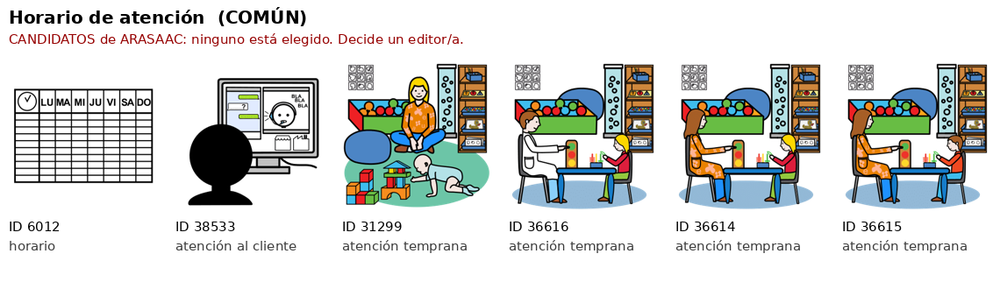 |
| Señal de espera | COMÚN | señal de espera | 35507, 27473, 24633, 16091, 24634 | 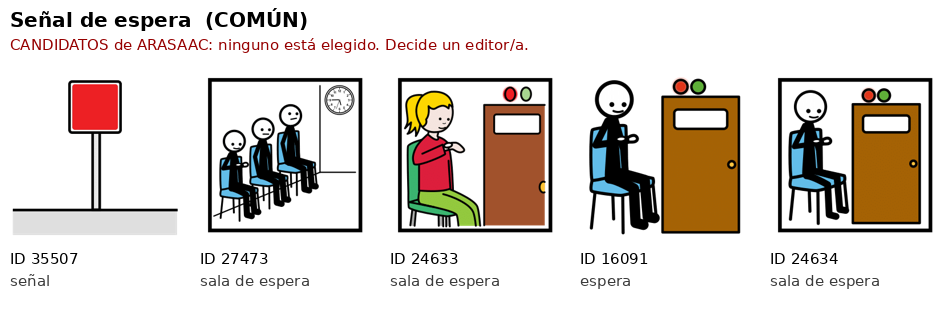 |
| Partida de nacimiento | Registro Civil | partida de nacimiento | 10275, 37981, 37980, 26320, 11213 | 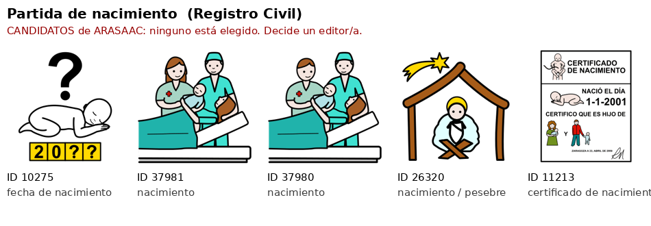 |
| Nacimiento | Registro Civil | nacimiento | 26320, 37980, 37981, 10275, 11213 | 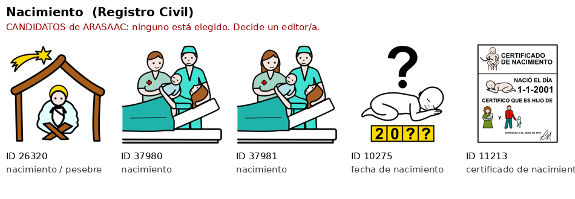 |
| Guardia / urgencias | Hospital y centros de salud | guardia / urgencias | 38082, 38776, 3342, 38386, 11279, 38387 | 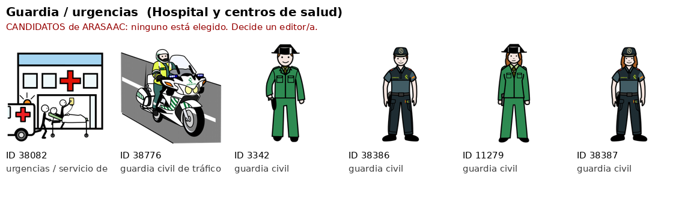 |
| Vacunación | Hospital y centros de salud | vacunación | 30072, 30073, 30074, 30703, 31714, 32057 | 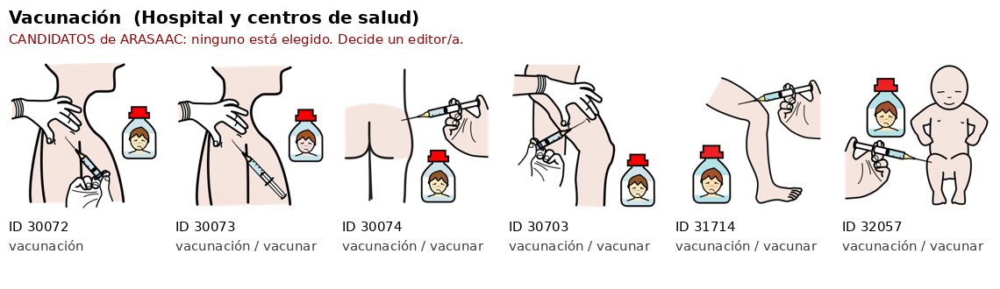 |
| Receta médica | Hospital y centros de salud | receta médica | 38606, 34609, 38850, 7805, 6561, 27143 | 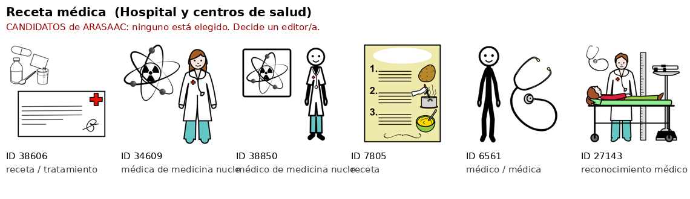 |
| Consultorio | Hospital y centros de salud | consultorio | 38870 | 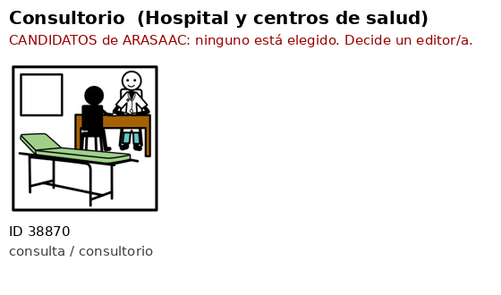 |
| Reclamo | Municipalidad | reclamo | ninguno encontrado (probar otra palabra) | — |
| Tasas municipales | Municipalidad | tasas municipales | ninguno encontrado (probar otra palabra) | — |
| Afiliación | PAMI | afiliación | ninguno encontrado (probar otra palabra) | — |
| Autorización | PAMI | autorización | ninguno encontrado (probar otra palabra) | — |
| Paquete | Correo Argentino | paquete | 38946, 5101, 9072, 38594, 25580, 38595 | 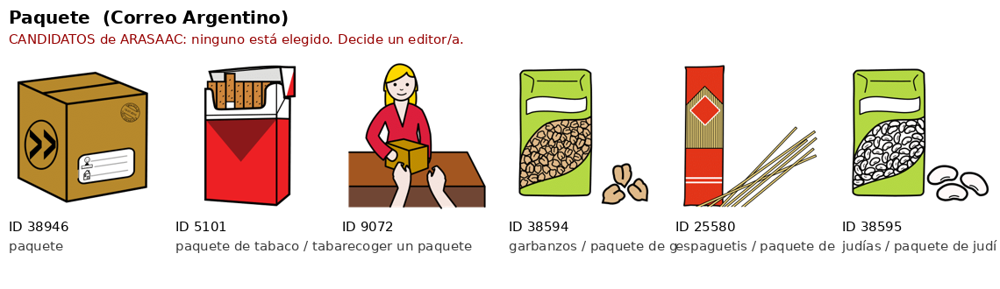 |
| Encomienda | Correo Argentino | encomienda | ninguno encontrado (probar otra palabra) | — |
| Retirar | Correo Argentino | retirar | 25405, 39928 | 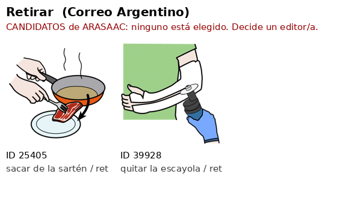 |
| Pasaje | Terminal de Ómnibus | pasaje | 39492 | 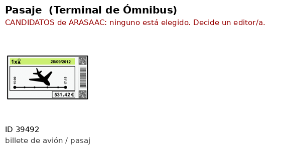 |
| Andén | Terminal de Ómnibus | andén | ninguno encontrado (probar otra palabra) | — |
| Equipaje | Terminal de Ómnibus | equipaje | 8562, 36661, 39583 | 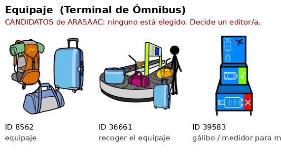 |
| Boletería | Terminal de Ómnibus | boletería | 24793, 34189 | 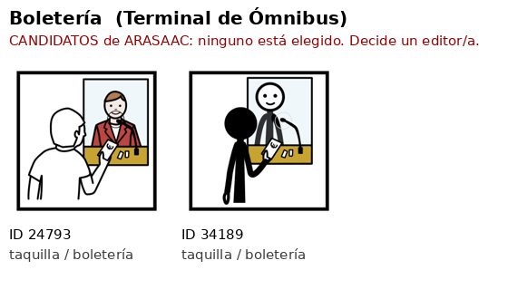 |

## Con imagen general (VERIFICADO_GENERICO_REVISAR_CONTEXTUALMENTE)

El pictograma está verificado, pero es genérico: la app lo muestra junto al texto específico y con la marca «imagen general». No implica que la institución ofrezca ese servicio.

| Concepto | Institución | ID | Observación |
|---|---|---|---|
| Ayuda | COMÚN | 4570 | Acción AYUDAR, no equivale a un mensaje completo. |
| Identificación de Registro Civil | Registro Civil | 36089 | Oficina es genérico, usar además nombre real y foto autorizada. |
| Me siento mal | Hospital y centros de salud | 28742 | Complementar con texto y voz. |
| Ayuda | Hospital y centros de salud | 4570 |  |
| Municipalidad | Municipalidad | 36089 | Pictograma de oficina genérica; el nombre institucional debe ir escrito. |
| PAMI | PAMI | 14664 | Salud es genérico; conservar nombre PAMI. |
| Ayuda | PAMI | 4570 |  |
| Correo | Correo Argentino | 3086 | Es un símbolo genérico; conservar nombre Correo Argentino. |
| Terminal | Terminal de Ómnibus | 38090 | Colectivo es genérico, no equivale a terminal. |
| Viajar | Terminal de Ómnibus | 2432 | Ir es genérico. |

Pictogramas: ARASAAC (https://arasaac.org), Gobierno de Aragón, autor Sergio Palao, licencia CC BY-NC-SA 4.0 (uso no comercial).
